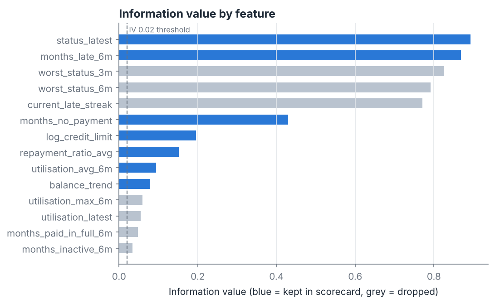
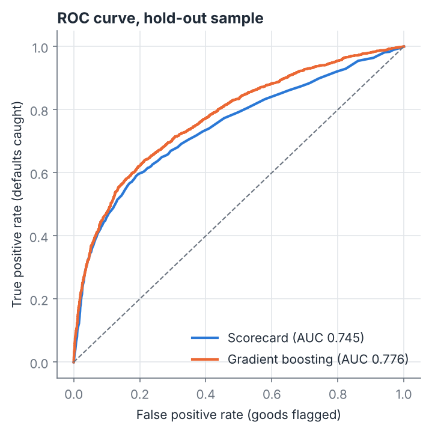
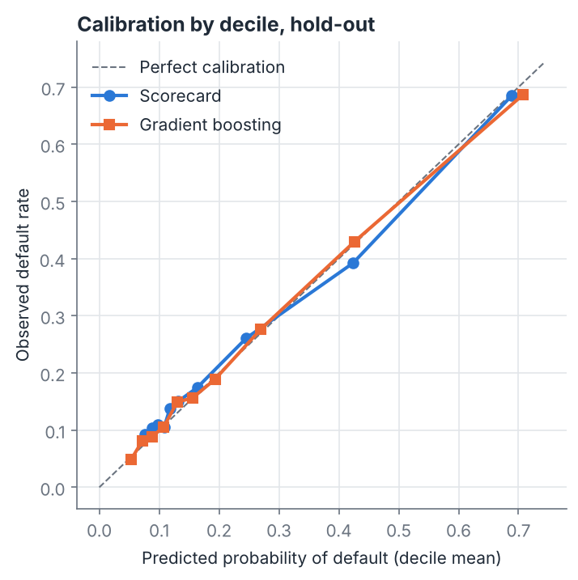
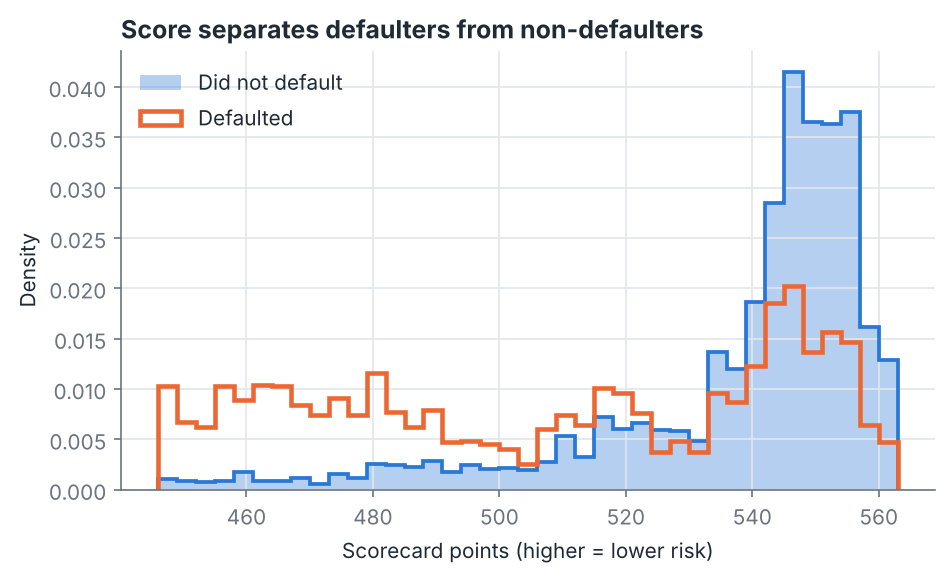
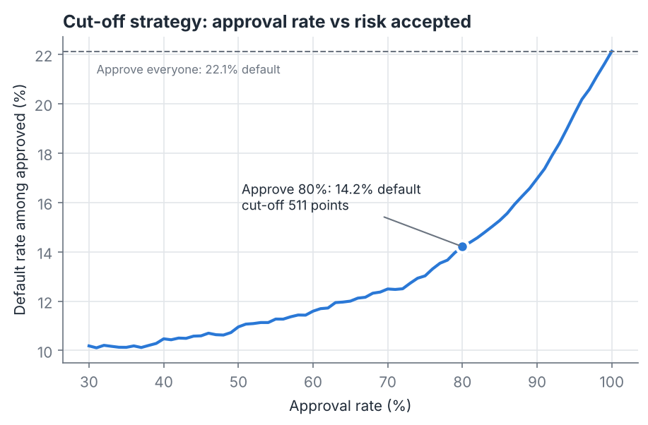

# Credit Default Scorecard

**A credit card default scorecard built the way a bank would build it: SQL feature layer, weight-of-evidence binning, an integer points table, validation against a machine-learning challenger, a cut-off strategy and fairness monitoring.**

[](https://github.com/Youssef-Remmal-tech/credit-default-scorecard/actions/workflows/ci.yml)
  

**[Interactive cut-off explorer](https://youssef-remmal-tech.github.io/credit-default-scorecard/)** · **[Model validation report](reports/model_validation_report.md)** · **[Notebook walkthrough](notebooks/walkthrough.ipynb)**

---

## The answer in 30 seconds

| | Scorecard (champion) | Gradient boosting (challenger) |
|---|---|---|
| Hold-out AUC | **0.745** | 0.776 |
| Gini | 0.490 | 0.552 |
| KS | 0.401 | 0.425 |
| Default rate at 80% approval | 14.2% | 13.7% |
| Inputs | 7 features, 35 bins, readable points table | 14 features, 200 trees |

- At an **80% approval rate** the scorecard cuts the default rate among approved customers from **22.1% to 14.2%** and declines **48.6%** of the customers who went on to default.
- The challenger's Gini advantage is real: **+0.062 (95% CI 0.047 to 0.078, paired bootstrap)**.
- **In business terms the gain is small:** at the same 80% approval rate it means about **37 fewer defaults per 9,000 applicants** (986 vs 1,023).
- Whether that justifies a black-box model is a business and governance decision. This repo puts the numbers in front of the person making it.
- **The score is stable:** PSI between the training and hold-out score distributions is 0.001, far below the usual 0.10 warning level.

## Business problem

A card issuer needs to decide who to approve, and at what limit, without seeing the future. A scorecard turns account behaviour into a points total that a credit team can read, challenge and set a cut-off against. Regulators expect that decision to be explainable, monitored, and free of unjustified bias. That is why UK lenders still use points-based scorecards alongside machine learning.

**Question:** using six months of account history, how well can we rank customers by their chance of defaulting next month, and what cut-off should the business choose?

## Data

**UCI "Default of Credit Card Clients"** (Yeh & Lien, 2009), a Taiwanese card issuer, April to September 2005. It is the same dataset that Kaggle hosts as [uciml/default-of-credit-card-clients-dataset](https://www.kaggle.com/datasets/uciml/default-of-credit-card-clients-dataset).

- 30,000 customers; 6,636 defaulted the following month (22.1%)
- 6 months of repayment status, bill amounts and payments per customer
- Licence: CC BY 4.0. The file is included in `data/raw/` and checked against a SHA-256 checksum on every run.

## Approach

```
data/raw/UCI_Credit_Card.csv
        │
        ▼  sql/01_staging.sql      clean codes, UNPIVOT wide → long (180,000 customer-months)
        ▼  sql/02_features.sql     window functions, gaps-and-islands, REGR_SLOPE → 14 behavioural features
        ▼  sql/03_checks.sql       data-quality gates (duplicates, row counts, nulls, target)
        │
        ▼  src/woe.py              monotonic weight-of-evidence binning, information value
        ▼  src/scorecard.py        feature selection → logistic regression → integer points
        │                          challenger: gradient boosting, 5-fold CV grid search
        ▼  src/evaluate.py         AUC/Gini/KS, calibration, paired bootstrap, PSI,
                                   cut-off strategy, fairness monitoring
```

**1. SQL feature layer (DuckDB).** The raw file is wide: one column per month. I unpivot it into one row per customer per month, then build features with window functions. The current late streak, for example, is a gaps-and-islands query that counts consecutive late months back from the latest statement. Every run stops if a data-quality check fails.

**2. Weight-of-evidence binning.** Continuous features are cut into up to 10 quantile bins, then merged until the default rate moves in one direction only, with no bin under 5% of customers. Repayment status codes are kept as categories, because −2 (no use), −1 (paid in full) and 0 (revolving) are not points on a scale.

**3. Feature selection with reasons logged** ([`outputs/tables/feature_selection.csv`](outputs/tables/feature_selection.csv)). The rules, in order:

- Keep features with information value of at least 0.02.
- Of any pair with WoE correlation above 0.75, drop the weaker one.
- Drop any feature that gets a counter-intuitive coefficient sign, because it would award points for looking riskier.

14 candidate features become 7.



**4. Points table.** The model is scaled so that 600 points corresponds to good:bad odds of 50:1, and every 20 points doubles the odds. Points are rounded to integers, as a credit team would use them. Full table: [`outputs/tables/scorecard_points.csv`](outputs/tables/scorecard_points.csv).

| Feature | Riskiest bin → safest bin (points) |
|---|---|
| Repayment status, latest month | 2+ months late **35** · 1 month late **63** · paid in full **81** · revolving or no use **88** |
| Months late in the last 6 | 3+ **60** · 2 **67** · 1 **71** · none **82** |
| Bills left completely unpaid | 2+ **66** · 1 **70** · none **78** |
| Credit limit | ≤ NT$30k **65** → > NT$359k **85** (8 bins) |
| Share of each bill repaid | < 4% **71** → paid more than the bill **81** |
| Balance trend | falling **72** → rising **77** |
| Average utilisation | 74 to 75 (weak once the features above are in) |

**5. Challenger.** A gradient-boosting model gets the same 14 behavioural features with no binning, tuned by 5-fold cross-validated grid search (CV AUC 0.786).

**6. Fairness by design.** Sex, age and marital status are protected characteristics under the UK Equality Act 2010. They are **not model inputs**. They are kept only to monitor outcomes.

## Results

All results are on a stratified 30% hold-out (9,000 customers) that was never used for binning, selection or tuning.

| Metric | Scorecard | Gradient boosting |
|---|---|---|
| AUC (train / hold-out) | 0.766 / **0.745** | 0.806 / **0.776** |
| Gini | 0.490 (CI 0.465–0.516) | 0.552 (CI 0.528–0.576) |
| KS | 0.401 | 0.425 |
| Brier score | 0.140 | 0.136 |

<p float="left">


</p>

Both models are well calibrated. The scorecard under-predicts slightly in seven of the ten deciles, by 1.1 to 2.0 percentage points; for example, decile 5 predicts 11.8% and observes 13.8%. The PD would need a calibration overlay before being used for pricing; ranking is unaffected.



### Choosing a cut-off



| Approval rate | Cut-off (points) | Default rate among approved | Defaulters declined | Good customers declined |
|---|---|---|---|---|
| 100% | 443 (lowest score) | 22.1% | 0% | 0% |
| 90% | 480 | 17.0% | 31.0% | 4.0% |
| **80%** | **511** | **14.2%** | **48.6%** | **11.9%** |
| 70% | 528 | 12.5% | 60.5% | 21.3% |

Every row comes from [`outputs/tables/cutoff_strategy.csv`](outputs/tables/cutoff_strategy.csv). Try any approval rate in the [interactive explorer](https://youssef-remmal-tech.github.io/credit-default-scorecard/).

### Risk grades

Grade boundaries are fixed in [`src/config.py`](src/config.py). Default rates rise strictly from A to E on both samples, and each grade's hold-out rate is within 2 points of its training rate.

| Grade | Score | Share of hold-out | Default rate (hold-out) | Default rate (train) |
|---|---|---|---|---|
| A | 545+ | 47.4% | 10.6% | 9.7% |
| B | 530–544 | 21.5% | 16.2% | 15.9% |
| C | 510–529 | 12.4% | 25.7% | 25.8% |
| D | 480–509 | 9.2% | 41.7% | 43.6% |
| E | below 480 | 9.5% | 69.5% | 69.9% |

### Decline reasons

Every score can be explained. `reason_codes()` lists the characteristics where a customer lost the most points against the best bin. For the customer just below the 80% cut-off (510 points):

1. Repayment status, latest month: 25 points lost
2. Months late in the last 6: 15 points lost
3. Bills left unpaid: 8 points lost

### Does the challenger's extra accuracy hold up in business terms?

A paired bootstrap (1,000 resamples of the same customers for both models) puts the challenger's Gini gain at **+0.062, 95% CI [0.047, 0.078]**. That is statistically clear.

At the business decision it shrinks. At an 80% approval rate the default rate among approved customers falls from 14.2% to 13.7%, about **37 fewer defaults per 9,000 applicants**. The challenger has 200 trees and no points table, so the extra 0.5 percentage points come at a cost in explainability, monitoring and model-risk governance. That trade-off belongs to the business, and this analysis gives it the numbers.

### Fairness monitoring at the 80% cut-off

| Group | Approval rate | Default rate if approved | Approval ratio vs highest group | AUC within group |
|---|---|---|---|---|
| Female | 81.6% | 13.3% | 1.00 | 0.744 |
| Male | 79.3% | 15.8% | 0.97 | 0.746 |
| Age 21–29 | 77.0% | 13.5% | 0.92 | 0.762 |
| Age 30–39 | 83.6% | 13.2% | 1.00 | 0.734 |
| Age 40–49 | 81.7% | 16.0% | 0.98 | 0.746 |
| Age 50+ | 79.2% | 17.2% | 0.95 | 0.725 |

- Every group's approval rate is within 8% of the highest group's, well above the common four-fifths screening threshold.
- The model ranks risk about equally well within each group (AUC 0.725 to 0.762).
- Approved older customers default more often (17.2% for 50+ vs 13.2% for 30–39). A monitoring team would watch this, because it suggests the score slightly understates risk for that group.

### Stability

The population stability index between the training and hold-out score distributions is **0.001**. Values under 0.10 are usually read as stable. Both samples come from the same period, so this is a baseline: in production it would be recomputed every month on new applicants.

## How to run

```bash
git clone https://github.com/Youssef-Remmal-tech/credit-default-scorecard.git
cd credit-default-scorecard
python -m venv .venv && source .venv/bin/activate      # Windows: .venv\Scripts\activate
pip install -r requirements.txt
python run_pipeline.py        # about 20 seconds: builds features, fits both models, writes outputs/
pytest -q                     # 8 tests: SQL checks, WoE monotonicity, points arithmetic, PSI, cut-offs
```

## Project structure

```
├── sql/                    DuckDB SQL: staging, features, data-quality checks
├── src/
│   ├── config.py           every setting in one place (features, thresholds, score scaling)
│   ├── build_features.py   runs the SQL, verifies the raw-file checksum
│   ├── woe.py              weight-of-evidence binning and information value
│   ├── scorecard.py        selection, logistic regression, points table, reason codes, challenger
│   ├── evaluate.py         metrics, bootstrap, calibration, PSI, cut-offs, risk grades, fairness
│   └── plots.py            README charts
├── tests/                  pytest suite
├── notebooks/              walkthrough.ipynb: the whole analysis, executed, in reading order
├── reports/                model_validation_report.md: model-risk style validation and findings
├── outputs/                figures, CSV tables, metrics.json (all regenerated by the pipeline)
├── docs/                   interactive cut-off explorer (GitHub Pages)
├── data/raw/               UCI source file (CC BY 4.0)
└── run_pipeline.py         one command, end to end
```

## Key decisions

| Decision | Why | What it cost |
|---|---|---|
| Points-based scorecard as champion | Readable by a credit team, gives decline reasons, simple to monitor | 0.062 Gini against the challenger |
| Sex, age and marital status excluded | Protected characteristics under the Equality Act 2010 | Outcomes are monitored by group instead; see the over-50s finding |
| Status codes treated as categories | The data shows "paid in full" is riskier than "revolving", so an ordinal scale would misstate risk | 5 bins instead of a smooth trend |
| Features with a positive coefficient removed | They would award points for riskier behaviour, which cannot be explained to a customer | 2 weak features (IV 0.034 and 0.048) |
| Binning, selection and tuning on training data only | The hold-out has to be a fair test | None; this is the cost of an honest number |

## Limitations

- **One period, one market.** Taiwan, 2005, a single issuer. There is no out-of-time sample, so the hold-out tests generalisation across customers, not across time.
- **Status codes.** The repayment status codes −2, −1 and 0 are documented inconsistently for this dataset. Treating them as categories lets the model learn their real risk: "paid in full" (−1) turns out riskier than "revolving" (0) here. A bank would confirm the codes with the data owner.
- **Balance trend.** Falling balances score as riskier. In this data that likely reflects accounts winding down before default, but it would need checking with the business before a model used it.
- **Next-month default only.** The target is one month ahead. Regulatory PD models (IFRS 9, IRB) need 12-month and lifetime horizons.
- **No reject inference.** Every customer here was already approved. A real application scorecard has to deal with customers who were never accepted.

## What I'd do next

- An expected-loss view (PD × LGD × EAD) with limit-setting by score band
- Monthly monitoring: PSI per feature, calibration drift, and an override log
- A Power BI version of the cut-off explorer connected to `outputs/tables/`
- A test of whether monotonic constraints on the gradient-boosting model close the explainability gap

## Data source and licence

Yeh, I. C. and Lien, C. H. (2009). The comparisons of data mining techniques for the predictive accuracy of probability of default of credit card clients. *Expert Systems with Applications*, 36(2), 2473–2480. Dataset: [UCI Machine Learning Repository](https://archive.ics.uci.edu/dataset/350/default+of+credit+card+clients), CC BY 4.0.

Code: MIT licence. See [LICENSE](LICENSE).

---

**Youssef Remmal** · Data & Risk Analyst · MSc Business Data Analytics, Bangor University · Four years in retail banking (KYC/AML, customer portfolio management)
[LinkedIn](https://www.linkedin.com/in/youssef-remmal-700318140/) · [GitHub](https://github.com/Youssef-Remmal-tech)
